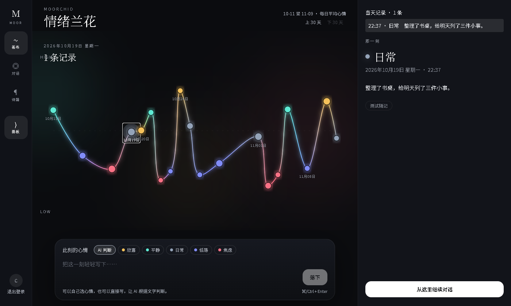
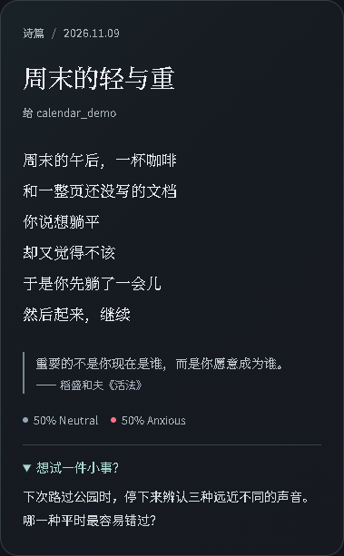
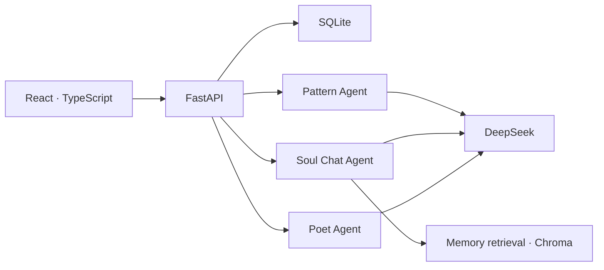

# Moorchid · 情绪随记

[中文](#zh) · [English](#en)

<a id="zh"></a>

写下今天发生的一件事，自己选心情，或让 AI 从文字中判断。过几天再回来，你可以沿着情绪曲线找到那一天，从那条随记继续聊。



## 产品功能

- **记录此刻。** 写一条随记，可以自己选择欣喜、平静、日常、低落或焦虑，也可以保留「AI 判断」。一天可以记录多次。
- **回看那天。** 画布默认显示最近 30 天，每个有记录的日期占一个节点，高度取当天各条记录情绪值的平均值。点开节点可以逐条查看原文。向前翻页可查看更早的记录。
- **从这里继续对话。** 从随记进入，会创建一个绑定该条记录的会话，后续提问可以直接说“那天”。也可以独立新建对话，由系统根据问题检索相关记忆。
- **生成诗篇。** 积累至少三条随记后，点击「生成诗篇」，把近期记录写成一首诗。卡尾可以附上一件与随记有关、随手能尝试的小活动，点「想试一件小事？」即可展开。卡片可以导出为 PNG。



## 技术架构和特点



FastAPI 根据用户操作调用对应的 Agent。Docker 镜像在构建时用 Vite 编译前端，运行时由同一个服务提供网页和 API。

| Agent | 触发时机 | 职责 |
| --- | --- | --- |
| Pattern | 保存随记 | 提取情绪、标签和事件线索。用户手选的心情优先。 |
| Soul Chat | 发送消息 | 结合会话历史与相关记忆生成流式回复。从旧随记进入时，额外带上该条记录的原文。 |
| Poet | 生成诗篇 | 根据近期随记创作诗文，并可在同一次生成中给出丰容活动。 |

SQLite 保存账号、随记、对话和诗篇，密码使用 bcrypt 哈希，登录使用 JWT。画布按用户和日期窗口查询数据，向前翻页时再读取旧记录。向量索引用于按内容检索记忆。配置 DeepSeek 后，生成任务会将相关文字发送给模型服务。

## 当前阶段和未来方向

**已实现：** 可在本机运行的作品演示版，已验证容器启动、登录、记录、画布翻页、流式聊天、诗篇生成及分享。项目具备单容器部署方式，尚未提供公共体验网址。

**计划中：** 优先发布带虚构数据的公网体验版；用真实模型测试跨日期的记忆检索和回答质量；在开放长期使用前，验证数据备份与恢复，并完善模型用量控制。

## 本地部署

安装并启动 Docker（含 Compose），在项目根目录新建活跃配置文件 `.env`。已有配置可直接沿用。用密码管理器生成至少 32 字节的随机密钥，或运行：

```sh
python -c "import secrets; print(secrets.token_hex(32))"
```

将结果填入 `.env`，以后重启沿用同一密钥：

```dotenv
JWT_SECRET_KEY=<替换为刚生成的随机密钥>
```

可选配置：`DEEPSEEK_API_KEY` 启用真实模型，`DEEPSEEK_MODEL` 指定模型，`ZHIPUAI_API_KEY` 启用远程向量嵌入。无模型密钥时可以试用内置演示逻辑。完整配置见 [.env.example](.env.example)。

```sh
docker compose up -d --build
```

打开 [本机应用](http://127.0.0.1:8000/) 注册账号。[健康检查](http://127.0.0.1:8000/health) 可查看服务状态。首次部署使用空数据库；截图来自独立的虚构数据演示环境。运行 `docker compose down` 停止服务。日记和索引保存在挂载到 `/data` 的命名卷中；`down -v` 会删除该卷。

<details><summary>开发模式：分别启动前后端</summary>

使用 Python 3.11 和 Node.js 22。在项目根目录创建虚拟环境（`python -m venv .venv`），激活后运行：

```sh
python -m pip install -r requirements.txt
python -m uvicorn main:app --reload --port 8000
```

在另一个终端运行以下命令，然后打开 [开发页面](http://localhost:3000/)。

```sh
cd UI
npm ci
npm run dev
```

</details>

<a id="en"></a>

## English

Moorchid is a mood journal. Write about a moment from your day and choose a mood, or let AI suggest one from your words. Later, follow the chart back to an entry and pick up the conversation from there. The [canvas and poetry screenshots above](#zh) use fictional entries.

### Features

- **Write a moment down.** Record as often as you like. Choose joy, calm, neutral, low or anxious, or leave mood detection on automatic.
- **Revisit a day.** The canvas opens on the last 30 days. Each dot represents a day with entries, and its height reflects their mean mood score. Open a dot to read every entry for that day, or page back to earlier dates.
- **Talk about an entry.** Opening a conversation from a journal entry keeps that entry in context across turns. Start a separate conversation to let retrieval find memories relevant to your question.
- **Create a poem.** After three entries, choose “生成诗篇” to turn recent moments into a poem. A card may include an optional small activity inspired by the journal. Expand the invitation to read it, or export the card as a PNG.

### Architecture and design

The [architecture diagram above](#技术架构和特点) shows a React and TypeScript client backed by FastAPI. Vite builds the frontend into the Docker image. One service serves both the web app and the API.

| Agent | Trigger | Responsibility |
| --- | --- | --- |
| Pattern | Save an entry | Extract mood, tags and event details. An explicit mood choice takes precedence. |
| Soul Chat | Send a message | Stream a reply using conversation history and retrieved memories. An entry-linked conversation also includes the original entry. |
| Poet | Request a poem | Compose a poem from recent entries and optionally suggest an activity in the same generation. |

SQLite stores accounts, entries, conversations and poems. Passwords are hashed with bcrypt and sessions use JWTs. The canvas queries one date window at a time. Chroma supports semantic memory retrieval. When DeepSeek is enabled, relevant journal or chat text is sent to the model service.

### Project status and next steps

**Available today:** a locally tested, containerized demo. Verified flows include sign-in, journal entry creation, historical chart navigation, streaming chat, poem generation and PNG export. A public demo URL is pending.

**Planned:** publish a demo with fictional entries, evaluate cross-day retrieval and answer quality with a live model, and verify backup, restore and model-usage controls before inviting people to keep long-term personal journals.

### Run locally

Start Docker with Compose. In the project root, create a `.env` file or reuse your existing one. Set `JWT_SECRET_KEY` to a persistent random secret of at least 32 bytes. A password manager or the following Python command can generate one:

```sh
python -c "import secrets; print(secrets.token_hex(32))"
```

```dotenv
JWT_SECRET_KEY=<replace with the generated secret>
```

Optionally set `DEEPSEEK_API_KEY` for live generation, `DEEPSEEK_MODEL` to select the model, and `ZHIPUAI_API_KEY` for remote embeddings. Without a model key, built-in demo logic is available. See the [environment template](.env.example).

```sh
docker compose up -d --build
```

Open the [local app](http://127.0.0.1:8000/) and register. The [health endpoint](http://127.0.0.1:8000/health) reports service status. A fresh installation starts with an empty journal. Stop with `docker compose down`. The named volume at `/data` retains entries and indexes. Adding `-v` deletes the volume.

<details><summary>Development mode with separate backend and frontend servers</summary>

Use Python 3.11 and Node.js 22. From the project root, create and activate a virtual environment (`python -m venv .venv`), then run:

```sh
python -m pip install -r requirements.txt
python -m uvicorn main:app --reload --port 8000
```

In a second terminal, run the following and open the [development app](http://localhost:3000/).

```sh
cd UI
npm ci
npm run dev
```

</details>
